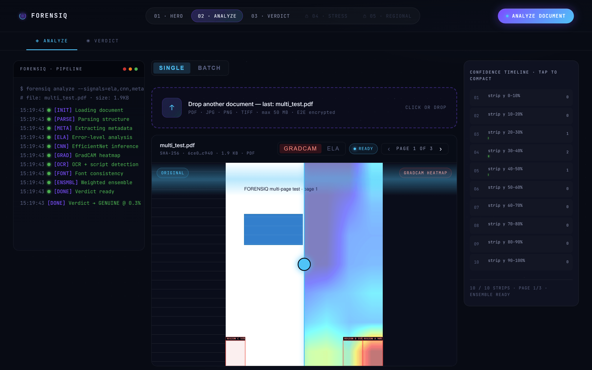
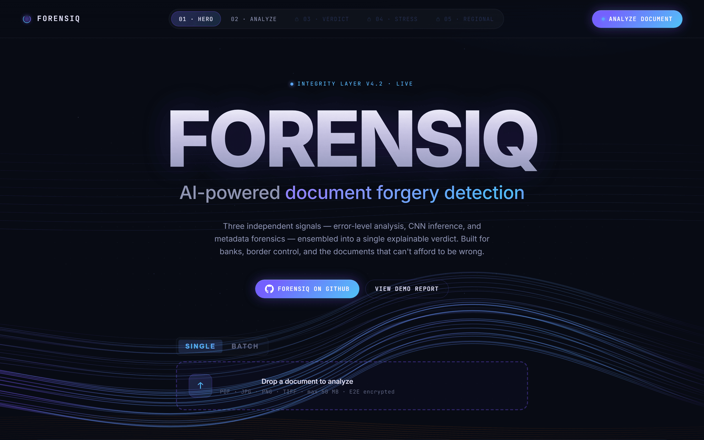
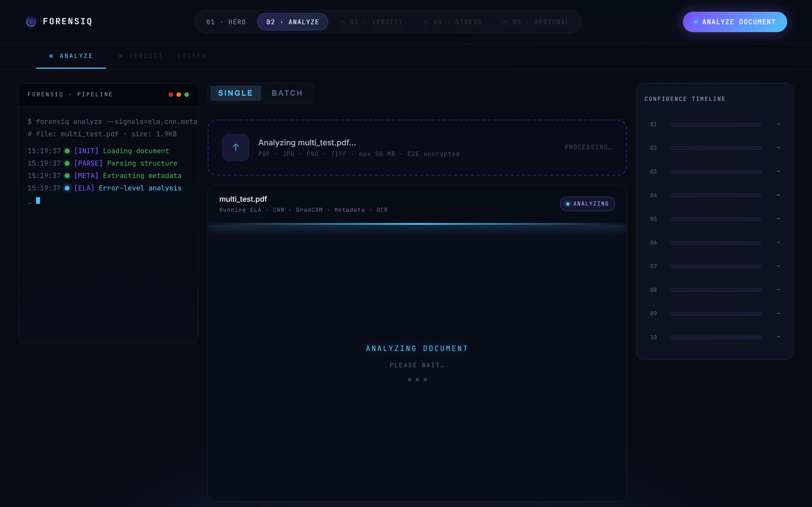

# FORENSIQ

> Document forgery detection that ensembles three independent signals into one
> explainable verdict, with a heatmap showing where the evidence is.

**Built for ThinkRoot × Vortex'26, NIT Trichy.**




## The problem

A forged document is not a document that looks wrong. It is a document that looks
right — because the whole point of forging one is to pass a human glance. The
alterations that matter are small and local: a changed digit in an amount, a
substituted name, a pasted signature, a date moved by a year. Everything around
them is genuine, which is exactly what makes them hard.

Any single detector has a blind spot that a forger can walk through. Error-level
analysis finds regions recompressed at a different quality than their surroundings,
which is powerful on a re-saved JPEG and useless on a document that was flattened
once at the end. Metadata forensics catches the editor that touched the file, and
catches nothing at all when the metadata is stripped. A learned classifier picks up
texture artefacts the other two miss, and cannot tell you why it fired. Font
analysis spots a substituted glyph run, and says nothing about an erased one.

Worse, the failure modes are not independent of the adversary. Anyone who knows
which single signal you check can defeat that signal specifically. So the design
question is not "which detector is best" but "how do you combine detectors whose
weaknesses do not overlap, and then show a human enough that they can disagree with
you".

That last part matters most. A verdict a reviewer cannot audit is a verdict a bank
cannot act on.

## Approach

FORENSIQ runs five analyses over every page and ensembles them into one score.

| Signal | What it catches | Where it is blind |
|---|---|---|
| Error-level analysis | Regions recompressed at a different JPEG quality than their surroundings | Single-pass flattened documents |
| CNN (EfficientNet-B0) | Learned texture and splice artefacts | Cannot explain itself without GradCAM |
| Font consistency | Substituted or re-typeset glyph runs, via MSER regions clustered with KMeans | Cleanly matched fonts |
| Metadata | Editing tool traces in EXIF / XMP / PDF structure | Stripped or rewritten metadata |
| OCR + script detection | Text-layer inconsistency across six Indic scripts | Non-text alterations |

**The ensemble is weighted by whether the CNN has actually been trained.** This is
the design decision worth pointing at. A fine-tuned checkpoint is not committed to
this repository, so out of the box the CNN is ImageNet-pretrained and untuned —
useful as a texture prior, not as a forgery classifier. `select_weights()` in
[`backend/utils/report.py`](backend/utils/report.py) detects this and switches to a
weight vector that leans on ELA, font and metadata instead. The system degrades to
the signals it can actually trust rather than reporting a confident number built on
an untrained model.

**Explainability is a first-class output, not a debug view.** Every verdict ships
with a GradCAM heatmap over the original page and a ten-strip confidence timeline,
so a reviewer sees *which region* drove the score and can overrule it.

## Features

| Capability | How it works |
|---|---|
| Five-signal ensemble | ELA, CNN, font, metadata and OCR combined with trained-aware weights |
| Explainable verdict | GENUINE / SUSPICIOUS / FORGED with a per-signal breakdown, never a bare score |
| GradCAM heatmap | Overlay on the original page render, with an original-vs-heatmap wipe control |
| Confidence timeline | Ten horizontal strips per page, each with its own flagged-region count |
| Multi-page PDF | Per-page analysis with page navigation; verdict aggregated across pages |
| Regional OCR | Six scripts — Tamil, Hindi, Telugu, Kannada, Malayalam, English |
| Adversarial stress | Apply brightness, JPEG recompression or copy-move and re-run, to probe robustness |
| PDF export | Client-side report generation with the heatmaps embedded |
| Batch mode | Queue several documents through the same pipeline |

## Screenshots

### Landing



The five stages are gated in order — stress testing and regional analysis unlock
only once a document has an actual verdict.

### Analysis in progress



The pipeline log is the interface. Each stage reports as it completes rather than
hiding behind a spinner, so a stalled signal is visible.

### A real verdict


`multi_test.pdf`, the repository's own committed test document, run end to end. The
pipeline log records every stage and the ensemble returns **GENUINE @ 0.3%**. The
GradCAM heatmap is wiped over the original render, and the confidence timeline on
the right shows which of the ten strips contributed flagged regions — here strips
03, 04 and 05, on a page the ensemble still judges genuine.

## Architecture

```
┌─────────────────────────────────────────────┐
│  Vite + React 18            localhost:5173  │
│  Landing → Analyze → Verdict                │
│  Regional · Adversarial · PDF export        │
└──────────────────┬──────────────────────────┘
                   │  fetch() / FormData
                   ▼
┌─────────────────────────────────────────────────────────┐
│  FastAPI  :8000                                         │
│                                                         │
│  POST /analyze                                          │
│    ├─ ELA       q=95 JPEG residual, 10-strip            │
│    ├─ CNN       EfficientNet-B0 + GradCAM               │
│    ├─ Font      MSER regions + KMeans                   │
│    ├─ Metadata  EXIF / XMP / PDF structure              │
│    └─ OCR       Gemini 2.5 Vision → EasyOCR fallback    │
│         └─ weighted ensemble → GENUINE/SUSPICIOUS/FORGED│
│                                                         │
│  GET /static/heatmaps/   ELA + GradCAM PNGs             │
│  GET /static/originals/  page renders                   │
└─────────────────────────────────────────────────────────┘
```

The signals are independent modules under `backend/model/` and `backend/utils/`,
each returning a score and its own artefacts. The ensemble is the only place they
meet, which is what makes the trained-aware reweighting a three-line change rather
than a refactor.

Full endpoint documentation is in [`docs/API.md`](docs/API.md). Keyboard shortcuts
and troubleshooting are in [`docs/OPERATIONS.md`](docs/OPERATIONS.md).

## Tech stack

| Layer | Technology | Why |
|---|---|---|
| Frontend | React 18, Vite 5 | The analysis view is stateful and chart-heavy; Vite keeps the rebuild loop fast |
| Charts | Recharts | Confidence timeline |
| PDF export | jsPDF, html2canvas | Report generation client-side, so documents never need re-uploading |
| API | FastAPI | Multipart upload plus long-running analysis on one typed surface |
| Vision | PyTorch, torchvision | EfficientNet-B0 and GradCAM |
| Imaging | Pillow, OpenCV | ELA residual and MSER region detection |
| OCR | Gemini 2.5 Vision, EasyOCR | Gemini for Indic script accuracy, EasyOCR as an offline fallback |

## Getting started

### Prerequisites

- Python 3.11
- Node.js 18 or later
- No `.env` is required; the OCR enrichment endpoints need a Gemini key to return
  narrative text, and everything else runs without one.

### Installation

```bash
git clone https://github.com/varadharajanv0310/FORENSIQ.git
cd FORENSIQ

python -m venv backend/.venv
backend/.venv/Scripts/python -m pip install -r backend/requirements.txt   # Windows
# backend/.venv/bin/pip install -r backend/requirements.txt               # macOS / Linux

cd frontend && npm install && cd ..
```

The backend pulls PyTorch, torchvision and EasyOCR, so expect a multi-gigabyte
download on first install.

### Configuration

| Variable | Required | Default | Purpose |
|---|---|---|---|
| `GEMINI_API_KEY` | No | — | Gemini 2.5 Vision OCR and the verdict narrative used in PDF export. Without it, OCR falls back to EasyOCR and the narrative endpoints return empty. |

### Running

Two terminals:

```bash
cd backend && .venv/Scripts/python -m uvicorn main:app --port 8000
```

```bash
cd frontend && npm run dev        # http://localhost:5173
```

The frontend expects the API on `http://localhost:8000` — this is hardcoded in
`frontend/src/services/api.js`, so the backend port is not freely configurable.

Check the backend is live and whether a fine-tuned CNN is present:

```bash
curl http://localhost:8000/health
# {"ok":true,"cnn_trained":false}
```

`cnn_trained: false` is the expected state on a fresh clone — see Approach for what
the ensemble does about it. Training is documented in `backend/model/train.py`.

## Project structure

```
FORENSIQ/
├── backend/main.py         # FastAPI surface — /analyze, /ocr, /enrich, /adversarial
├── backend/model/          # inference.py (EfficientNet), gradcam.py, ela.py, font_analysis.py
├── backend/utils/          # report.py — the weighted ensemble and trained-aware weights
├── backend/static/         # generated ELA + GradCAM heatmaps and page renders
├── frontend/src/           # React app — analyze view, verdict view, adversarial stress
└── docs/                   # API.md, OPERATIONS.md, screenshots
```

## Limitations

- **No fine-tuned CNN is committed.** On a fresh clone the classifier is
  ImageNet-pretrained and untuned. The ensemble compensates by reweighting, but the
  CNN signal is not doing forgery detection until someone runs `model/train.py`
  against a labelled corpus.
- **No committed benchmark.** An earlier version of this README quoted a detection
  accuracy figure over a held-out set. No evaluation artefact, corpus or script in
  this repository produces that number, so the claim has been removed rather than
  restated. There is currently no reproducible accuracy measurement.
- **Not validated against real forged documents.** Development used synthetic
  alterations and the adversarial stress tools in this repository. Real forgeries
  are produced by people optimising against detection, which synthetic edits do not
  model.
- **ELA is weak on flattened documents.** A document rendered once to PDF with no
  re-save leaves little compression residual, which removes the strongest signal.
- **Backend URL is hardcoded** in the frontend, so a non-default port needs a code
  change.
- **Not a legal instrument.** A verdict here is a triage aid for a human reviewer,
  not evidence.

## Roadmap

- Publish a labelled evaluation corpus and an evaluation script, so accuracy is
  reproducible rather than asserted
- Ship a fine-tuned EfficientNet checkpoint, or a documented command to obtain one
- Per-signal confidence in the exported PDF, so a reviewer sees which detector fired
- Make the API base URL configurable from the frontend environment
- Extend adversarial stress with print–scan simulation, the most common real-world
  laundering step

## Team

Built at ThinkRoot × Vortex'26, NIT Trichy, by **V Varadharajan** (lead),
**Abishek VPT** and **L Prashanth**.
